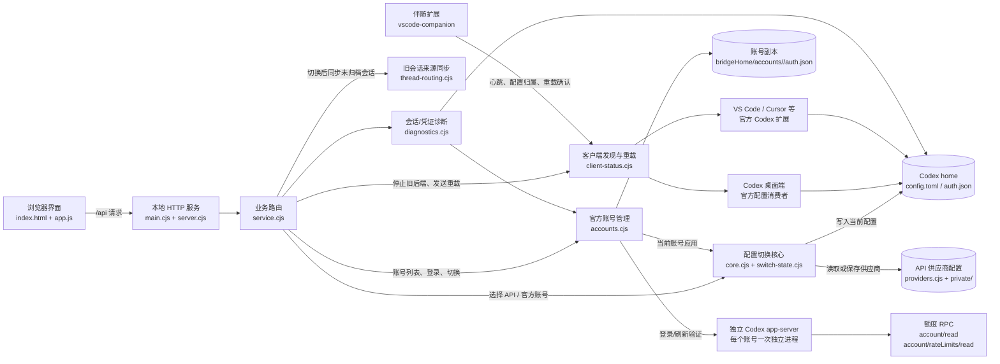

# Codex API 切换器当前架构

这份图按当前源码整理，重点说明“切换配置”和“官方账号/额度”两条路径如何汇合到本地 Codex。

## 一次官方账号切换

1. 页面把账号 id 发给 `service.cjs`。
2. `accounts.cjs` 准备账号登录；需要续期或验证时，通过 `official-session.cjs` 调用独立的 Codex `app-server` 做 `account/read(refreshToken=true)`，并检查编辑器重载通道。
3. 关闭目标桌面端后，`accounts.cjs` 写入所选账号凭证，`core.cjs` 恢复官方配置。
4. `client-status.cjs` 停止共用配置的旧编辑器后端，再由 `thread-routing.cjs` 同步并核对旧会话来源。
5. 重新打开目标桌面端，并向已连接的伴随扩展发送编辑器窗口重载请求。

添加账号时，每次登录使用 `accounts/login/<随机标识>/` 独立目录。登录完成通知必须匹配本次 `loginId`；通知早于 start 响应时先暂存，收到响应后处理。成功状态先提交再关闭登录进程，旧通知不覆盖结果；失败时保留已写入的凭证和脱敏原因，方便恢复。

## 一次额度刷新

1. 页面按账号 id 调用 `accountQuota`，不持有配置切换锁。
2. `accounts.cjs` 为该账号启动独立的 Codex `app-server`，读取同一账号副本。
3. 先读账号状态，再调用 `account/rateLimits/read`。
4. `quota-reader.cjs` 统一限制最多同时处理两个账号，网页拆开的单账号请求和批量请求共用名额；同一账号的重复请求（包括排队中）仍会合并。
5. 成功时写入该账号的 `quota.json`。
6. 失败时保留上次成功时间，但界面不再显示旧额度数字，只显示失败原因和结构化错误类型。

## 凭证状态的判断边界

- `auth.json` / macOS 钥匙串是官方登录凭证来源；不会为额度另造一份账号凭证。
- access token 的 JWT `exp` 只能说明访问令牌到期，不能单独证明整个官方 session 失效。
- 诊断遇到过期 access token 时，会调用官方账号验证；成功就显示“官方登录仍可用”，明确鉴权失败才提供重新登录操作。
- 网络失败、超时和额度服务暂时不可用不会被改写成“登录失效”。

## 代码入口

| 层 | 文件 | 责任 |
| --- | --- | --- |
| 启动 | `main.cjs`、`server.cjs` | 启动本地服务、页面会话和 API 路由 |
| 业务 | `service.cjs` | 把页面操作编排成切换、账号、额度、诊断任务 |
| 配置 | `core.cjs`、`switch-state.cjs` | 原子写入配置、快照、切换状态和恢复 |
| 官方账号 | `accounts.cjs` | 登录副本、账号切换和对外账号接口 |
| 官方会话 | `official-session.cjs` | 独立 app-server 生命周期、JSON-RPC 和错误分类 |
| 额度读取 | `quota-reader.cjs` | 额度 RPC、统一两个并发、账号级请求合并、额度缓存和结构化错误 |
| 客户端 | `client-status.cjs`、`vscode-companion/` | 发现窗口、确认配置归属、请求重载和记录结果 |
| 会话诊断 | `diagnostics.cjs`、`thread-routing.cjs` | 旧会话错误证据、来源同步和可见上下文导出 |
| 页面 | `index.html`、`app.js` | 来源选择、账号列表、额度和客户端状态展示 |
