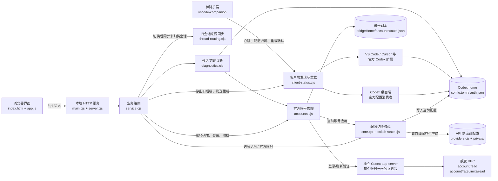

# Codex API 切换器当前架构

这份图按当前源码整理，重点说明“切换配置”和“官方账号/额度”两条路径如何汇合到本地 Codex。

后端按职责存放在 `src/accounts/`、`src/config/`、`src/clients/`、`src/diagnostics/`、`src/server/` 和 `src/platform/`。`src/paths.cjs` 统一定位项目根目录；根目录 `main.cjs` 只转交启动，保证快捷方式和默认用户数据路径不随目录整理改变。

## Windows 与 Mac 共用的功能边界

账号、额度、配置应用、旧对话同步、后台切换任务、步骤耗时和窗口重载协议共用实现；平台层只负责运行程序发现、凭证存储、进程读取与退出、应用启动。不能因为没有桌面版就停用账号或切换功能。

| 安装情况                                                          | 账号登录与额度                                     | 应用配置     | 客户端更新                                                       |
| ----------------------------------------------------------------- | -------------------------------------------------- | ------------ | ---------------------------------------------------------------- |
| 仅官方 Codex 编辑器扩展（VS Code、Insiders、Cursor、Windsurf 等） | 使用当前编辑器安装的官方 app-server                | 共用切换任务 | 只停止共用目录的插件后端，再由伴随扩展重载对应窗口；不启动桌面版 |
| 仅 Codex 桌面版                                                   | 使用桌面版自带的官方 app-server                    | 共用切换任务 | 重启目标桌面端并确认新进程                                       |
| 桌面版与编辑器同时使用                                            | 优先用户指定或伴随扩展上报的运行程序，也可自动发现 | 共用切换任务 | 分别处理共用目录的桌面与插件，独立目录不跟随                     |

`src/platform/runtime.cjs` 独立发现当前编辑器渠道安装的官方运行程序，不通过桌面应用启动才能登录。伴随扩展会从编辑器扩展清单识别 OpenAI 的 Codex/ChatGPT 扩展，不依赖单一扩展 ID；只负责窗口通信与重载，不承担账号登录或额度 RPC。是否参与切换由实际本机 Codex 后端的 PID 归属和配置目录决定，远程工作区或 WSL 设置只是窗口信息，不能否定已确认的本机后端；真正使用远端配置的后端不随本机切换。

心跳成功只代表连接到了切换器服务。`clientHeartbeat` 返回 `connection.state`（`ready`、`unmatched`、`separate`）、管理目录和关联后端 PID，伴随扩展据此显示“已接入”“后端未关联”或“独立配置”。`companionHost` 由扩展实际运行位置上报，窗口标签或使用 SSH 连接电脑的方式都不能代替进程归属证据。关联优先使用 PID/祖先链，其次使用唯一通信标识；实际运行于远端宿主的扩展还可按唯一配置目录关联。重载后必须等新的 Codex 后端关联到共用配置，才确认重载完成；这仍不代表已经通过真实模型请求验证了官方登录或上游额度。

`src/clients/desktop-account.cjs` 的 `runSwitch()` 统一生成步骤及耗时，`web/app.js` 统一渲染；没有按系统拆分的旧版切换页面。`src/platform/build-info.cjs` 为运行代码生成一次构建标识，新入口只复用同构建后台，避免新包连接旧后台继续显示旧页面。页面底部显示版本和构建标识，便于核对实际运行版本。

## 一次官方账号切换

1. 页面把账号 id 发给 `src/server/service.cjs`。
2. `src/accounts/accounts.cjs` 准备账号登录；需要续期或验证时，通过 `src/accounts/official-session.cjs` 调用独立的 Codex `app-server` 做 `account/read(refreshToken=true)`，并检查编辑器重载通道。
3. 关闭目标桌面端，并由 `src/clients/client-status.cjs` 停止共用配置的旧编辑器后端；停止前保留窗口身份，以便后端退出后仍能发送重载。
4. 重新保存退出时更新的当前登录，再由 `src/accounts/accounts.cjs` 写入所选账号凭证、`src/config/core.cjs` 恢复官方配置，最后通过 `src/diagnostics/thread-routing.cjs` 同步并核对旧会话来源。
5. 重新打开目标桌面端，并向已连接的伴随扩展发送编辑器窗口重载请求。

准备阶段并行执行账号/API 验证与编辑器归属检查，全部收尾且通过后才能关闭客户端和应用配置；任一检查失败都保留配置。Windows 使用随包构建的 C# 进程助手通过 Toolhelp32、QueryFullProcessImageNameW 和目标进程内存读取完成扫描，异步等待助手时不阻塞登录 RPC；开发源码安装会先构建该助手。关闭阶段复用该阶段新取得的进程树，按已确认进程的退出信号等待，共享两秒保存时限，强制停止后仍确认实际退出。后台切换进程在父进程完成锁交接、写入排队状态并通过 IPC 发出开始消息后执行，不再固定等待 1.5 秒。这些优化不依赖缩短账号校验或使用旧验证结果。

两端的编辑器后端和 Mac 桌面使用 `src/platform/process-stop.cjs`：发送 SIGTERM 后最多等待 1.5 秒，仍未退出的已确认进程使用 SIGKILL，再等待真实退出。权限错误直接回报，不当作已经退出。客户端归属取最近的桌面或编辑器宿主，避免由 Codex 终端启动的编辑器被误归为桌面端。

添加账号时，每次登录使用 `accounts/login/<随机标识>/` 独立目录。登录完成通知必须匹配本次 `loginId`；通知早于 start 响应时先暂存，收到响应后处理。成功状态先提交再关闭登录进程，旧通知不覆盖结果；失败时保留已写入的凭证和脱敏原因，方便恢复。

旧对话按目标供应商和模型筛选；未指定模型时先解析默认模型，再跳过已经匹配的会话。速度设置从历史末尾按 64 KiB 块读取，不解析聊天正文。超过四条的批次由两个官方后端动态分担，总在途数仍最多四条，失败后停止派发并等待在途任务结束；更新后仍重新启动后端逐条核对持久结果。Windows 进程扫描按 PID 查询父进程，关闭桌面时只查询目标进程，保留真实退出确认和独立配置隔离。10 秒是常见切换场景的优化目标，耗时仍受账号服务、历史大小和客户端退出速度影响。

## 一次额度刷新

1. 页面按账号 id 调用 `accountQuota`，不持有配置切换锁。
2. `src/accounts/accounts.cjs` 为该账号启动独立的 Codex `app-server`，读取同一账号副本。
3. 先读账号状态，再调用 `account/rateLimits/read`。
4. `src/accounts/quota-reader.cjs` 统一限制最多同时处理两个账号，网页拆开的单账号请求和批量请求共用名额；同一账号的重复请求（包括排队中）仍会合并。
5. 成功时写入该账号的 `quota.json`。
6. 失败时保留上次成功时间，但界面不再显示旧额度数字，只显示失败原因和结构化错误类型。

## 凭证状态的判断边界

- `auth.json` / macOS 钥匙串是官方登录凭证来源；不会为额度另造一份账号凭证。
- access token 的 JWT `exp` 只能说明访问令牌到期，不能单独证明整个官方 session 失效。
- 诊断遇到过期 access token 时，会调用官方账号验证；成功就显示“官方登录仍可用”，明确鉴权失败才提供重新登录操作。
- 网络失败、超时和额度服务暂时不可用不会被改写成“登录失效”。

## 本地诊断日志（0.1.3）

`src/diagnostics/event-log.cjs` 集中处理脱敏、同步追加和日志轮换。切换任务记录开始、客户端快照、逐步骤耗时与终态；服务只在窗口关联状态改变时记录心跳事件；官方登录、准备及额度读取记录各自的错误类型。进程链取自同一次扫描的 `inventory.ancestry`，最多八级，不记录完整命令行、环境变量、配置正文或对话正文。

日志保存在数据目录的 `logs/switcher.log`，超过 2 MiB 后于下一次写入时轮换，最多保留三份。`exportDiagnostics` 读取实时环境头与最近 2000 行，页面通过 Blob 下载；不会上传日志。公共 `pid` 是写入进程，`companion.state.editorPid` 是编辑器宿主，避免两者混淆。`switch.end.reload` 如实保存任务结束时已经观测到的窗口状态，不将仍在等待的重载写成完成。

## 运行开销与请求调度（0.1.3）

首屏并行请求账号、来源状态和客户端列表。周期性心跳缓存每个窗口的连接结果：已接入窗口每 30 秒复核，未关联或独立配置每 5 秒复核；首次登记、PID 改变和重载完成回报都会复核，修改管理目录后清空连接缓存。普通复核共享全服务 2.5 秒内的进程快照，多个窗口不会各自重复扫描；重载完成回报强制重新读取进程，避免用旧后端确认新窗口。切换前的归属检查仍使用实际进程快照。

窗口登记的内容发生变化时立即落盘；内容未变时每隔至少 5 秒更新一次 `seenAt`，登记有效期仍为 15 秒。重载命令由请求方立即写入，心跳每次读取现有命令，接收或失败确认变化时立即保存。

Mac 的心跳与客户端列表通过异步 `ps` 枚举进程，再并行调用各后端的原生读取助手，等待期间不阻塞服务的事件循环。桌面发现和一次性同步操作保留同步入口，两个入口共用进程解析与错误报告逻辑。

首次启动完整收紧数据和发现目录的权限，成功后写入仅含规范化路径的 `acl-protected.json`。后续启动路径一致时复用结果，目录迁移后重新执行；收紧失败不写标记，照常上报 `dataDirProtection.ok=false`。首次收紧仍在建立监听和写入凭证之前执行。

伴随扩展协议 3 使用长轮询：支持的服务会声明 `longPoll:true`，扩展收到回复后继续发起最长 10 秒的等待。服务只在等待期间每 250 ms 检查登记文件的修改时间，发现重载命令立即回复；结束等待后按原有缓存期限确认连接状态，避免返回等待前的旧状态。HTTP 连接关闭时通过 AbortSignal 清理检查与超时定时器。确认和完成回报立即返回，重载语义不变；完成确认尚未接入时保留 2 秒节奏，防止忙循环。旧服务继续使用 2 秒节奏，连接失败后等待 5 秒；请求超时为 15 秒，登记有效期仍为 15 秒。

## 代码入口

| 层       | 文件                                                                    | 责任                                                         |
| -------- | ----------------------------------------------------------------------- | ------------------------------------------------------------ |
| 启动     | `main.cjs`、`src/server/server.cjs`                                     | 启动本地服务、页面会话和 API 路由                            |
| 业务     | `src/server/service.cjs`                                                | 把页面操作编排成切换、账号、额度、诊断任务                   |
| 配置     | `src/config/core.cjs`、`src/config/switch-state.cjs`                    | 原子写入配置、快照、切换状态和恢复                           |
| 官方账号 | `src/accounts/accounts.cjs`                                             | 登录副本、账号切换和对外账号接口                             |
| 官方会话 | `src/accounts/official-session.cjs`                                     | 独立 app-server 生命周期、JSON-RPC 和错误分类                |
| 额度读取 | `src/accounts/quota-reader.cjs`                                         | 额度 RPC、统一两个并发、账号级请求合并、额度缓存和结构化错误 |
| 客户端   | `src/clients/client-status.cjs`、`vscode-companion/`                    | 发现窗口、确认配置归属、请求重载和记录结果                   |
| 会话诊断 | `src/diagnostics/diagnostics.cjs`、`src/diagnostics/thread-routing.cjs` | 旧会话错误证据、来源同步和可见上下文导出                     |
| 事件日志 | `src/diagnostics/event-log.cjs`                                         | 切换事件脱敏落盘、轮换和诊断导出读取                         |
| 页面     | `web/index.html`、`web/app.js`                                          | 来源选择、账号列表、额度和客户端状态展示                     |
